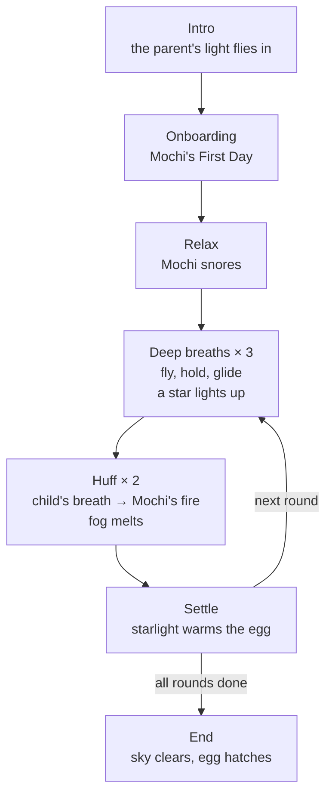

# Mochi's Breathing Adventure: What We Built

A WebXR "pop-up book" demo that turns a child's daily airway-clearance practice (ACBT) into helping a little dragon, Mochi, bring colour back to a sky island covered in sleepy fog.

**Try it:** <https://laplandog.github.io/arr-hackathon/>
In a desktop browser, drag to look around and press **Space** to move on. In a VR headset, open the same link in the headset's browser and tap **Enter VR**.

> **This is a demo, not a product.** Breathing is not sensed yet (a parent confirms each stage), it has not been tested with children, and every rhythm number is a placeholder, not a clinical setting.

## At a glance

| | |
| --- | --- |
| Built in | About 10 hours (5 Nov 17:17 → 6 Nov 03:14) |
| Commits | 35 (29 development, 6 art uploads) |
| Game code | 16 JavaScript modules, 4,714 lines |
| Asset tools | 8 Python scripts, 983 lines |
| Art in the scene | 61 images from our artist, plus 16 placeholder images drawn by code |
| Sound | 4 music tracks, 27 recorded narration lines, 6 sound effects |

Line counts leave out blank lines.

## The idea

**How can we turn "I have to do this" into "I want to do this"?**

One action, two experiences. For the parent, it is a prescribed care routine. For the child, the same breaths help Mochi fly, warm up and melt the fog.

## How a session flows

The parent can pause or end gently at any point, and progress is always kept.

## What's in the demo

### 1. Child-led onboarding: "Mochi's First Day"

Our tutor's advice was to let children try the interactions before practice starts. So there is no manual. Mochi runs into small problems, and the child works out how to help. Mochi never demonstrates; it copies the child.

| Step | What's wrong with Mochi | What the child does | How we know | What happens |
| --- | --- | --- | --- | --- |
| 1 Look | Asleep in its nest | Looks at Mochi | Headset direction | Mochi wakes up |
| 2 You move, I move | Seems to be copying you | Tilts, turns or nods | Headset movement | Mochi copies each move |
| 3 Relax together | Yawning and sleepy | Stays still | Head speed | Fireflies drift closer and settle in front of the child |
| 4 Breathe in | Wants to fly but can't | Just watches | — | Fireflies lift Mochi, a drop falls on its head, it glides down |
| 5 Huff | Frozen icy blue, shivering | A warm "haaa" | Parent confirms | Colour comes back and Mochi breathes fire |
| 6 Cough (optional) | A seed stuck in its throat | A small cough | Parent confirms | The seed flies away |
| 7 Warm the egg | The egg is cold and shivering | A warm "haaa" | Parent confirms | The egg glows warm, then practice begins |

- **Hint ladder:** wait quietly → say what's wrong → give a clue → say how to help. As soon as the child does it, the remaining hints are skipped.
- **No failure:** if the child does nothing, the world finishes the step by itself and the story carries on.
- **Order on stage:** Mochi's move and the huff or cough sound always finish before the praise line, so every recorded line plays in full.

### 2. The practice round as a story

- **Relax:** Mochi snores in its nest. The child just breathes naturally.
- **Deep breaths × 3:** Mochi flies up into a glowing comfort band, hovers, then glides down. Each full breath sends a spark up to light a star.
- **Huff × 2:** a puff of warm air flies from the child's mouth into Mochi. Mochi breathes fire, one patch of fog melts, and that part of the island gets its colour back.
- **Settle:** Mochi flies home, and starlight warms the dragon egg by one stage.
- **End:** the sky clears, the stars close into an egg shape, and the egg cracks open with the parent's light and Mochi beside it.

### 3. A world that heals around the child

- **Colour returns in four zones,** far to near and from the centre outwards: the far islands, the left island, the right windmill island (its windmill starts turning), then the flowers, the nest and the ground under the child's feet.
- **Life follows progress:** paper birds take off from islands that get their colour back, butterflies come out once the flowers bloom, and dandelion seeds around the child grow warmer and more numerous.
- **Dragon egg:** cold → warm glow → gentle wobble → crack → hatch.
- **Constellation:** one star per deep breath (2 rounds × 3 breaths = 6 stars), joined by golden arcs.

### 4. Sound that carries the rhythm

- Four music tracks (made with Suno) follow the stage: intro, flying, the main lullaby and the ending. They switch with equal-power crossfades and loop seamlessly.
- 27 English narration lines recorded by our team. They are trimmed and levelled automatically, and the music dips while the narrator speaks.
- Sound effects for snoring, breathing in, breathing out, huffing, the falling drop, colour coming back and coughing. All are trimmed and kept quieter than the voice and the music.

### 5. The parent as a glowing light

Every button the parent presses becomes something the child can see the light do.

| Key | When | The light | Result |
| --- | --- | --- | --- |
| Space | Start, or between stages | Flies to Mochi with a star | Mochi wakes up or starts the next stage |
| Space | The child huffed | Flashes | Warm air → fire → fog melts |
| Space | Onboarding: the child did it | — | Mochi reacts and the narrator praises |
| T | Onboarding: the child is stuck | — | The narrator gives the next hint |
| S | Onboarding | — | Skips to practice |
| P | Any time | Snuggles up to Mochi | Mochi rests, music softens, the timer freezes |
| E | Any time | Flies home with Mochi | Gentle ending, progress kept |
| R | A new session | Goes back far away | Everything resets |
| C / B | Only if the care plan includes cough / percussion | Wiggles at Mochi's nose / blinks to the beat | Sneeze / wingbeats |

### 6. Safety by design

- No failure screen, no score and no "miss". Progress never goes backwards, even after a pause or an early end.
- Rewards are fixed per completed step. Breathing harder never makes the flame bigger or Mochi fly higher.
- Coughing only appears if the care plan includes it, and it is asked once.
- The game never tells the child that the fog is mucus.
- The viewpoint is fixed. Only Mochi and small, slow things move, to keep the child comfortable.
- The parent can always pause or end.

### 7. Engineering

- **Template-driven:** rounds, breaths, timings, huffs, cough, percussion and onboarding on/off all live in [`public/config/template.json`](public/config/template.json). A clinician's template can replace it without code changes.
- **Scene from data:** [`public/assets/layout.json`](public/assets/layout.json) places layered paper cut-outs with grey-to-colour materials, auto-trimmed edges, a 360° sky and aerial perspective.
- **Art pipeline:** [`tools/`](tools/) has scripts that cut sprite sheets, align Mochi's poses, recolour stars, push the scene back in depth and draw paper-craft placeholders.
- **Missing art never breaks the demo:** placeholders show their file name, and an artist replaces one by uploading a file with the same name.
- **Words without code:** narration lives in [`public/config/voice.json`](public/config/voice.json); the recording script is [`docs/voice-script.md`](docs/voice-script.md).
- **Deployment:** every push to `main` goes live on GitHub Pages, with cache-busting asset versions.
- **Stack:** Three.js, WebXR, Vite and plain JavaScript, with no server.

## How we iterated

Each step below came from team or tutor feedback, newest first.

| When | What | Changes |
| --- | --- | --- |
| 6 Nov 03:08–03:14 | Demo polish | Mochi sways before the first hint and nods before the praise; huff and cough sounds finish before the praise line; cough step turned on with a recorded cough; softer huff |
| 6 Nov 02:49 | Listening fixes | The drop vanishes on Mochi's head; wavy shiver marks; equal-power music crossfades; narration never cut off |
| 6 Nov 02:13–02:29 | Narration and sound effects | 27 recorded English lines; snore, breathe-in, breathe-out, drop and revive effects |
| 6 Nov 01:20–01:29 | Music and script | Four music tracks by stage; bilingual recording script |
| 6 Nov 00:32–01:01 | Onboarding | "Mochi's First Day", then two rounds of feedback: fireflies lift Mochi, a falling drop, icy-blue cold Mochi, an uncomfortable face for the stuck seed, Mochi copies after the child, warming the egg |
| 5 Nov 23:28 | Ambient life | Birds, butterflies and dandelion seeds that follow progress |
| 5 Nov 23:02 | Surroundings | Paper ground, side islands and windmill, clouds all around |
| 5 Nov 22:44 | Egg and constellation | One star per deep breath; starlight warms the egg each round; hatching at the end |
| 5 Nov 22:24 | Flowers | Paper-craft flowers that bloom |
| 5 Nov 19:31–20:51 | Depth and second art batch | 360° sky, scene pushed back, aerial perspective; flames, cloud bands, grass, geometric paper pieces |
| 5 Nov 18:08–19:24 | First art batch | Poses, six-colour paper stars, clouds, grass, Zzz, the light, fog, nest; six uploads by our artist |
| 5 Nov 17:17 | First playable | Scene, state machine, Mochi, effects and keyboard control; repository and GitHub Pages |

## Team and credits

| Who | What they made | How the demo uses it |
| --- | --- | --- |
| Zixun Zhou ([ZHOUQINGQING666](https://github.com/ZHOUQINGQING666)) | VR demo development: state machine, onboarding, Mochi animation, egg and constellation, scene, effects, sound, parent controls, art integration, deployment | Everything in this repository's code |
| lilili ([lilili444](https://github.com/lilili444)), art | Mochi's 7 poses; sky and islands; paper stars, Zzz and the light; 4 fog puffs, 15 clouds, 2 cloud bands; grass, nest, flame frames, geometric paper pieces | Cut out, aligned and placed in the scene |
| bb, mechanics spec v0.1 | Characters, stages, rhythm-game mechanics, comfort band, parent controls, rewards, safety rules | State machine, egg, constellation, the light's actions and every safety rule |
| Team, research proposal | Medical background, user and competitor research, visual guidelines, windmill island and dragon egg concepts | Windmill island, egg and art style |
| Task brief (author to be added) | Scope, asset naming, layering conventions, state machine and keys | The first build |
| Teammates, narration | 27 recorded English lines | All narration |
| Our tutor | "Let children try the interactions before they start" | The whole onboarding |

Music was generated with Suno. The cough sound is the first second of a clip from the 光厂 (VJshi) sound library; sources for the other effects are to be added.

Development was assisted by Claude Code, an AI coding assistant. Zixun decided and reviewed the gameplay and visuals; the AI wrote the code, placeholder art and tool scripts to that direction, and every version was checked in the browser before going live.

## What's next

- **Sense breathing:** breath detection and a chest-vibration sensor for percussion, with the parent's button kept as a backup.
- **Parent app:** guidance, pause and end, and session records a clinician can review.
- **Native build:** Unity with OpenXR for Quest and other headsets, working offline with Bluetooth sensors, plus a tablet mode for children too young for a headset.
- **Reasons to come back:** the 20-egg collection the team has designed, rebuilding the island, raising hatched dragons and mini-games. Rewards stay capped by the care plan, so playing more never means breathing more.
- **Testing:** sessions with families and physiotherapists, and tuning the head-tracking thresholds in a headset.
- **Polish:** longer music (each track is 15–21 seconds today), the remaining sound effects, and final art for the placeholders.

For setup, keys and the asset list, see the [README](README.md) (in Chinese).
